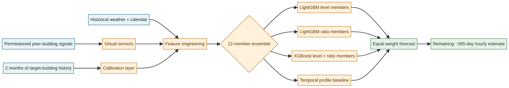
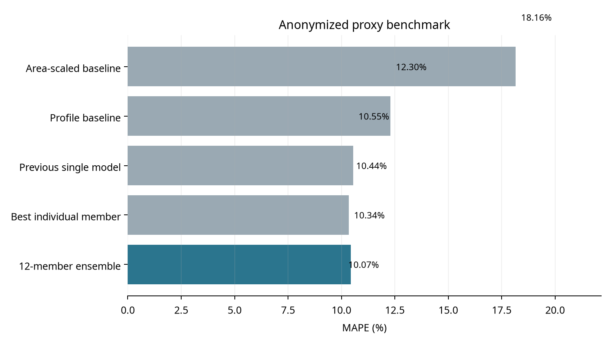

# Case Study: Cold-Start Building Energy Forecasting

## Context

During an academically supervised R&D internship in Tallinn, I worked on an hourly electricity-demand forecasting problem. I was given only two months of target-building data and asked to estimate the remaining roughly 365-day forecast period.

The public case study removes the host organization, supervisor identity, building codes, exact locations, raw readings, and all deliverable files. It focuses on the modeling reasoning and engineering decisions.

*Figure 1. High-level architecture of the virtual-sensor and 12-member ensemble approach.*

## Why the problem is difficult

The target's observed history is short and seasonal. A model trained only on two winter months can produce a plausible-looking but structurally wrong summer forecast. Randomly splitting adjacent hours would also overstate performance because neighboring observations share weather, occupancy, and calendar patterns.

## Virtual-sensor method

Concurrent loads from peer buildings contain information about shared schedules, term-time activity, holidays, and campus-wide changes. I used these signals as **virtual sensors** rather than treating the target as an isolated time series. The peer series do not directly measure the target building; they provide indirect signals about the shared environment.

Peer loads were represented as relative activity compared with each peer's calibration-period mean and as load per heated square metre. The target's own calibration-period mean supplied the absolute level.

## Fixed 12-member ensemble

The final model averaged twelve members with equal weights. The ensemble combined shallow, regularized LightGBM level models, LightGBM ratio models, XGBoost level and ratio models, and a target-only weekday/hour profile baseline.

Members differed in target scaling, loss function, feature subsets, and monotonic donor constraints. Equal weights were fixed in advance because tuning blend weights on only a few proxy buildings would overfit.

## Validation that mimics deployment

I used blind leave-one-building-out validation. Each fully observed peer was temporarily treated as the unseen target: only its first two months were exposed for calibration, while the later period was held out for scoring. Additional checks included a winter-to-winter forward test on the real target and short time-ordered splits.

The pipeline also validated local-time row order, daylight-saving behavior, missing values, positive predictions, and complete hourly coverage.

*Figure 2. Blind leave-one-building-out validation flow.*

*Figure 3. Aggregated benchmark comparison; no raw building series are included.*

## Results and communication

The public profile headline reports **12.42% MAPE** and a **0.9456 correlation coefficient** over 7,344 hourly observations. The internal anonymized proxy benchmark reported approximately **10.1% MAPE** for the fixed ensemble, approximately **10.4%** in a two-peer robustness check, and approximately **5.4%** in a same-building winter forward check. These figures represent different validation summaries and are intentionally labeled separately.

The largest errors appeared farther from the two-month calibration period, especially in summer. Midday and Saturday hours were more difficult than night hours. SHAP analysis showed that normalized peer-building activity was more influential than many individual weather variables. This explains model behavior but does not prove causal building physics.

## Production and commercial relevance

The project was designed around production constraints: reproducible environments, one-command execution, pinned dependencies, strict input/output gates, interpretable diagnostics, and executive-level communication of uncertainty. The same pattern applies to cold-start bottlenecks in new SaaS, energy, and industrial-IoT deployments.

## Next steps

With permissioned data, the next iteration would add building-use metadata, HVAC and cooling information, occupancy proxies, and at least one summer month of target observations. For a true year-ahead system, peer-load and weather forecasts would also be required instead of observed covariates.

## Ethics and data handling

The public version deliberately omits raw data and all operationally identifying outputs. Any future publication of the underlying measurements would require explicit approval from the data owner and host organization.
